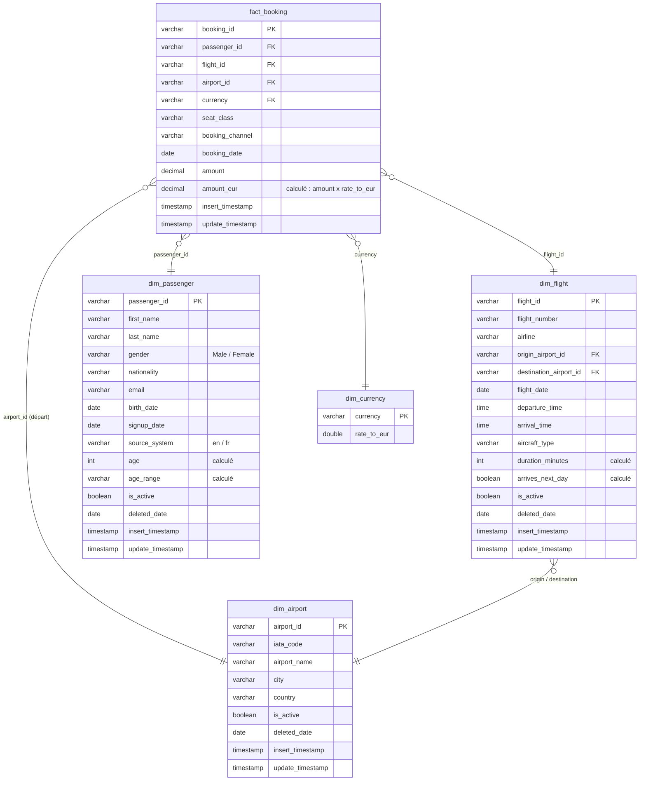
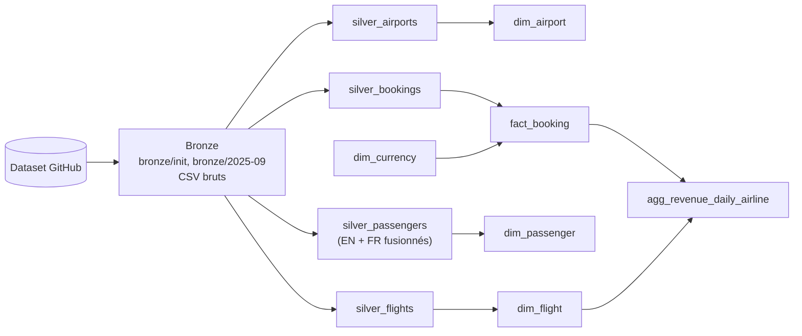

# Documentation — choix de modélisation et de chargement

## Résumé

Le pipeline ingère chaque jour 5 exports (aéroports, vols, passagers EN et FR, réservations) en
trois couches. **Bronze** : fichiers CSV copiés tels quels dans `bronze/`. **Silver** : une table
par entité dans DuckDB, typée et consolidée. **Gold** : un schéma en étoile autour d'une table de
fait `fact_booking`, avec quatre dimensions et un agrégat de chiffre d'affaires. Les vols, les
passagers et les aéroports sont des **dimensions** : ce sont des référentiels qui évoluent, livrés
en export complet chaque jour. On les charge par **upsert**, et une ligne qui disparaît de la
source est **désactivée**, jamais supprimée. Les réservations sont des **évènements immuables**
livrés en incrémental : c'est le **fait**, chargé par **insert simple** et idempotent.

Pour reconstruire l'entrepôt depuis zéro : `python ingestion/run_month.py`, qui rejoue l'init puis
les 30 jours de septembre (environ 25 s).

## Modèle de données (gold)

Table agrégée, à part de l'étoile : `agg_revenue_daily_airline`, avec une ligne par
`booking_date` × `airline`. Elle contient `nb_bookings`, `revenue_eur`, `avg_basket_eur` et les
deux timestamps techniques.

## Flux des données

Chaque entité a son script (`ingestion/ingest_<entité>.py`) avec trois fonctions,
`ingest_bronze`, `ingest_silver` et `ingest_gold`. Chacune relit uniquement ce que la couche
précédente a écrit (un fichier sur disque, puis une table DuckDB). `run_month.py` exécute chaque
couche pour les 4 entités avant de passer à la suivante, parce que le contrôle d'intégrité des
réservations en silver a besoin des vols et des passagers du jour, et que l'agrégat gold a besoin
de `dim_flight`.

## Fait ou dimension : ce que l'exploration a montré

| Source | Clé | Export | Évolution d'un jour à l'autre | Rôle |
|---|---|---|---|---|
| airports | `airport_id` | complet | quasi figé (1 modification et 1 ajout sur le mois) | dimension |
| flights | `flight_id` | complet | 0 à 5 évènements par jour : ajouts, modifications d'horaire, d'avion ou de date, suppressions | dimension |
| passengers_en / _fr | `passenger_id` / `id_passager` | complet | nouveaux passagers chaque jour, corrections et suppressions rares | dimension |
| bookings | `booking_id` | **incrémental**, seulement les réservations du jour | une réservation ne change jamais | **fait** |

Une réservation est un évènement daté, avec une mesure additive (`amount`), qui ne change plus
une fois créée : c'est la définition d'un fait. Les trois autres fichiers décrivent le contexte
d'une réservation (qui, quel vol, d'où). Ce contexte peut être corrigé avec le temps : ce sont
des dimensions. Le grain de `fact_booking` est **une ligne par réservation**.

## Stratégies de chargement

**Bronze.** `fetch_csv` télécharge le fichier octet par octet, sans passer par pandas, seulement
s'il n'est pas déjà présent sur disque. Le bronze est donc une copie exacte de la source, et le
rejouer ne télécharge rien une seconde fois. Les deux fichiers passagers restent séparés : la
fusion est une transformation, elle appartient au silver.

**Silver des dimensions : upsert + désactivation.** Comme chaque fichier est un export complet,
on le compare à ce qui est déjà en table :

- **clé nouvelle** : on l'insère, avec `insert_timestamp = update_timestamp = now()` ;
- **clé existante dont une valeur a changé** : on l'écrase avec
  `INSERT … ON CONFLICT DO UPDATE … WHERE <colonne> IS DISTINCT FROM excluded.<colonne>`.
  Ce filtre fait que `update_timestamp` ne bouge que lors d'un vrai changement. Sans lui, la
  colonne vaudrait chaque jour la date du dernier chargement et ne dirait plus rien.
  `insert_timestamp` n'est jamais réécrit ;
- **clé absente du fichier du jour** : la ligne a été supprimée à la source. On la passe en
  `is_active = false` et on fixe `deleted_date` au jour où la disparition est constatée. On ne
  fait jamais de `DELETE`. Dans les données actuelles, **774 réservations portent sur un vol
  désactivé et 64 sur un passager désactivé**. Un `DELETE` les aurait laissées sans référence ;
- **clé désactivée qui réapparaît** : elle est réactivée et `deleted_date` repasse à `NULL`.

**Consolidation des passagers.** Les deux CRM sont réunis dans un seul schéma, avec les noms de
colonnes EN. Pour le fichier FR, on renomme les colonnes, on traduit `Homme/Femme` en
`Male/Female` et on convertit les dates `DD/MM/YYYY` en `DATE`. Une colonne `source_system`
garde la trace du CRM d'origine. Les identifiants ne se chevauchent pas entre les deux sources,
donc un `UNION ALL` suffit, sans déduplication. La désactivation se fait sur l'ensemble des deux
fichiers, pour qu'un passager FR ne soit pas désactivé parce qu'il manque au fichier EN.

**Silver des réservations : insert simple.** Le fichier ne contient que les réservations du jour.
Une réservation absente le lendemain n'a donc pas été supprimée, et la logique de désactivation
serait ici une erreur. On utilise `INSERT … ON CONFLICT (booking_id) DO NOTHING`, ce qui permet
de rejouer un jour sans créer de doublon. Après chaque chargement, un contrôle signale (sans
rejeter de ligne) les réservations dont le vol ou le passager est inconnu, et celles dont
`airport_id` diffère de l'aéroport de départ du vol. Sur le mois, il ne remonte aucune anomalie.

**Gold : reconstruction complète.** Chaque table gold est recréée (`CREATE OR REPLACE`) à partir
de l'état courant du silver. Le gold est donc idempotent par construction et ne dépend pas d'une
date. Les attributs calculés :

- `dim_flight.duration_minutes` : arrivée − départ, + 24 h quand l'arrivée est avant le départ.
  Ces vols de nuit représentent environ un quart des vols ; sans cette correction, leur durée
  serait négative. Les durées obtenues vont de 60 à 780 minutes ;
- `dim_passenger.age` et `age_range` (0-17, 18-24, 25-34, 35-49, 50-64, 65+) : l'âge exact est
  calculé à une **date de référence fixe**, le 30/09/2025 (`AGE_REFERENCE_DATE`). Avec
  `current_date`, le gold changerait d'une exécution à l'autre sans que la donnée change ;
- `fact_booking.amount_eur` : `amount × dim_currency.rate_to_eur`, arrondi au centime.

Les montants sont stockés en `DECIMAL` plutôt qu'en `DOUBLE`, pour que les sommes soient exactes
au centime. Pour vérifier, la somme de `amount_eur` dans `fact_booking` et celle de
`revenue_eur` dans l'agrégat sont identiques : 13 816 123,96 €.

**Où vit l'agrégat.** `agg_revenue_daily_airline` est construit dans `ingest_gold` de bookings,
juste après `fact_booking`. Il ne dépend que de `fact_booking` et de `dim_flight` (pour la
compagnie), et `dim_flight` est reconstruite avant lui dans la boucle gold.

## Limites connues

- **Pas d'historique des modifications (SCD1).** Une correction (horaire d'un vol, email d'un
  passager) écrase l'ancienne valeur. On ne peut pas savoir quel avion était affecté à un vol à
  une date passée. Une historisation SCD2 est nécessaire pour ça (bonus non traité).
- **Durées en heures locales.** La source ne donne pas de fuseau horaire. `duration_minutes` est
  donc la différence entre les heures affichées, et non le temps de vol réel pour les vols qui
  changent de fuseau.
- **Âge à date fixe.** L'âge est celui au 30/09/2025, et non l'âge au moment de chaque
  réservation. Pour une analyse par âge au moment de l'achat, il faudrait le calculer dans le
  fait à partir de `booking_date`.
- **Réservations sur vols annulés comptées dans le CA.** La source n'indique ni annulation de
  réservation ni remboursement. Les 774 réservations portant sur un vol désactivé restent donc
  dans le chiffre d'affaires. Elles peuvent être exclues en filtrant sur `dim_flight.is_active`.
- **Taux de change fixes**, sans date de valeur, fournis par `dim_currency`.
- **Dépendance à l'export complet.** Si un jour la source livrait un fichier vide ou tronqué, le
  pipeline désactiverait tous les vols ou passagers absents. Un garde-fou, par exemple refuser
  un snapshot dont la taille chute brutalement, serait nécessaire en production.
- **Contrôle d'intégrité non bloquant.** Une réservation orpheline serait chargée et signalée
  dans les logs, pas mise en quarantaine.
- **Pattern d'`update_timestamp` hétérogène.** `silver_airports` (code fourni) rafraîchit
  `update_timestamp` à chaque chargement, alors que `silver_flights` et `silver_passengers` ne le
  font que lors d'un vrai changement.
- **Gold entièrement reconstruit chaque jour.** C'est simple et suffisant pour ce volume
  (~39 000 réservations), mais ne passerait pas à l'échelle. Il faudrait alors charger
  `fact_booking` en incrémental.
